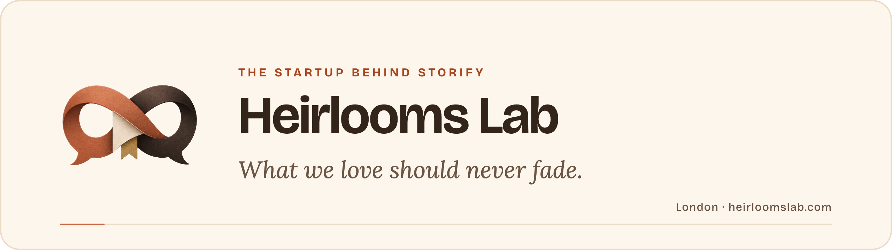
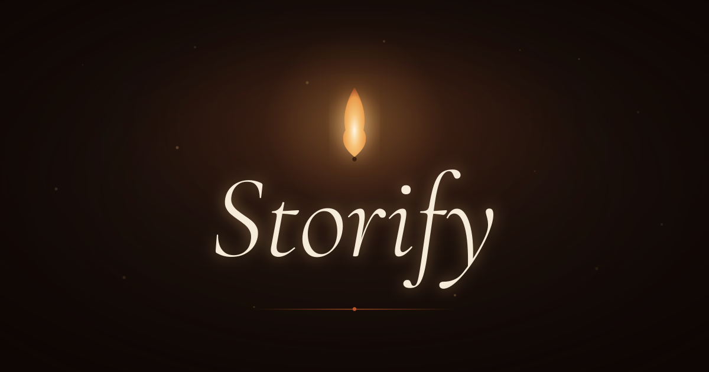

  <picture>
    <source media="(prefers-color-scheme: dark)" srcset="assets/banner-dark.png">
    
  </picture>

  
  
  
  

 

> *Your phone is full of voices, laughter, whole afternoons. Nobody ever saves them, so they go first. We're building the software that keeps them.*
>
> — Omar and Marco, co-founders

## Who we are

Heirlooms Lab is a London technology startup. We build software that keeps the conversations that matter, starting with **Storify**.

## Storify

**An AI app that reads a WhatsApp chat and gives it back as something to keep, to play and to share.**

<table>
  <tr>
    <td width="33%" valign="top">
      <b>The story</b>  
      An illustrated story in chapters, written from the whole chat, in the narrative voice you choose.
    </td>
    <td width="33%" valign="top">
      <b>Rewind</b>  
      The chat retold in a minute of slides: the first message, the topics, the nicknames, how well you click.
    </td>
    <td width="33%" valign="top">
      <b>The quiz</b>  
      Who knows the other better? Send the challenge with a link; the other person can play on the web, no app needed.
    </td>
  </tr>
</table>

| | |
|---|---|
| **Stage** | Private beta. Launching on iPhone and Android on 10 November 2026. |
| **Business model** | Free to try, with in-app purchases on the App Store and Google Play. |
| **Technology** | Our own AI pipeline, with the API on Google Cloud in the EU. |

  

## How we build

- **Your chat stays yours.** It is encrypted on your phone before it reaches us. The chat and the text of your story are stored encrypted; we decrypt them only in memory while we work on them, and we never store your key.
- **No selling, no ad tracking.** We do not sell personal data and we do not share it for advertising.
- **A small team, built with AI.** Two co-founders working with Claude every day, as part of Claude for Startups.

  
  
  
  
  
  
  
  

## The team

<table>
  <tr>
    <td width="50%" align="center" valign="top">
       
      <b>Omar</b> 
      Co-founder · AI, engineering and growth  
      Ten years between models and servers. The AI inside the app is his, and so is keeping it standing once it's in people's hands.  
      <a href="https://github.com/omarcotugno">@omarcotugno</a>
    </td>
    <td width="50%" align="center" valign="top">
       
      <b>Marco</b> 
      Co-founder · Product, design and strategy  
      Takes everything we could build, decides which version is worth building, and draws it before we argue about it.  
      <a href="https://github.com/markmayer00">@markmayer00</a>
    </td>
  </tr>
</table>

## Follow Storify

  
  
  
  
  

 

  Heirlooms Lab Ltd · Registered in England and Wales · Company number 17404768 · London, United Kingdom

